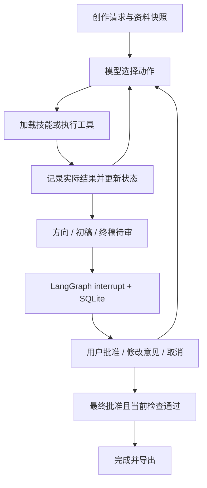

# 方案：模型决策、可核验工具与三阶段人工审核

## 架构与职责

项目采用一个主 Agent。LangGraph 图负责模型调用、工具执行和人审恢复；模型决定加载哪个技能、查询什么、怎样改稿、何时请求审核或说明未完成。Python 负责结构校验、数值计算、版本绑定及完成条件，不能靠模型的一句“检查通过”改变状态。

三个业务工具是 `search_materials`、`estimate_duration` 和 `check_rules`。`load_skill` 是技能加载设施；提交方向、完整提交／局部修改稿件、请求审核、追问和未完成结束是控制动作。业务技能不等同于独立 Agent，也不等同于一个必经图节点。

模型也可以用 `patch_script` 局部修订已保存稿件。暴露给模型的 schema 每次只允许 1 项编辑，并列出当前稿件中实际存在的路径；数组索引从 0 开始，不是 `scene_id`。`replace` 分支要求字符串 `value`，可修改标题、镜头文字与引用字段；`remove` 分支不接受 `value`，只可删除来源 ID 或断言条目。不能改时长要求、估时参数、检查结果或删除镜头。底层纯函数支持 1 至 20 项有序原子编辑，在副本中全部验证成功才返回；任一步失败均不修改原稿。成功编辑生成新版本并清空旧检查，与完整稿提交采用相同的终稿门槛。这是为真实测试中“复制整稿而没有改动”的问题增加的小粒度编辑能力，不代表当前模型已成功完成修订链路。

可用动作根据真实前置条件过滤：未取得来源与方法时不能提交稿件；用户初稿先执行两项检查，再暴露编辑动作；同一版本、需求和资料 hash 已有的检查不重复提供，服务失败可再试；已有方向先等待审核；修改稿件后检查重新可用。已加载技能不再出现在加载选项中，但完整正文仍保留在上下文；`used_skills` 仅允许已加载 ID，并限制列表长度。未修改的方向或稿件提交会被拒绝。模型仍在合法动作中选择检索、加载方法、编辑、追问或停止，程序没有预设下一次查询或修改文字。这是带前置条件的动态决策范围，不能用前置过滤本身证明模型具备重规划能力。

当前环境和依赖锁定文件使用 **LangGraph 1.2.18** 与 **langgraph-checkpoint-sqlite 3.1.2**。前者提供 `StateGraph`、条件路由、`interrupt()` 及 `Command(resume=...)`，后者提供 `SqliteSaver`。项目自行实现业务工具、版本约束、模型接口、技能加载和本地恢复锁，没有重新实现框架的图调度或 checkpoint 机制。

图允许以方向、初稿、终稿为执行骨架，但骨架内的下一动作由真实模型通过显式配置的动作协议选择。每轮仅接受一个工具动作，先观察返回再继续。批量调用会得到可见错误，避免同一轮同时修改稿件并审核旧版本。普通文本的成功声明不能直接完成任务。

## 模型接口和失败边界

模型适配层使用标准 Chat Completions 请求。`LLM_ACTION_PROTOCOL=native` 为默认值，发送工具 schema、`tool_choice="auto"` 和 `parallel_tool_calls=false`，接收服务返回的原生 `tool_calls`。服务地址、模型名称、密钥与超时可配置；本次用户提供的地址是 `http://127.0.0.1:8012/v1`，模型名是 `qwen25-14b-pbn-answer`。评审运行时需要自己的可访问服务，不能把开发者的 localhost 当作远程服务地址。

显式设置 `LLM_ACTION_PROTOCOL=json` 时，请求使用 `response_format.type="json_schema"` 和 `strict=true`。每个可用动作对应一个 `anyOf` 分支，以 `const` 固定动作名并绑定其参数 schema；服务必须支持这些结构化输出能力。动作定义也作为提示词发送，不发送原生工具调用参数。模型必须返回单个 `{"action":"动作名","arguments":{...}}` 对象；适配层再次校验动作属于当前可用集合、字段封闭、参数类型和数值／长度约束，拒绝重复 JSON 键及非法数值。解析器可接受单个完整 JSON 代码块，但不从混杂说明或多个对象中猜取动作。通过校验后，适配层生成标明来源的内部调用 ID，交给同一个图和真实工具执行；工具观察继续回传模型。JSON 上下文不把旧 assistant 动作重放成输出示例，保留真实观察、当前状态和动作摘要，完整历史仍保存在 Trace。独立事实核验使用原来的单独提示词，不切换为动作协议。

两种协议均为真实模型选择动作，不是预设动作或 Mock。协议由配置明确选择，失败不触发静默切换。完整业务接入曾观察到长脚本 JSON 出现在普通正文却没有被服务解析为原生 `tool_calls`；JSON 协议用于显式适配这一接口差异，实际采用的协议、原始可公开响应及结果应根据评估文件核对，不能据配置选项存在就宣称已通过。

代码默认协议是 `native`；本次 `.env.example` 显式选择 `json`，超时 120 秒、输出预算 2048 token。当前本地模型尚未完成正常脚本的完整业务链路；结构化格式正确、工具可执行以及工程测试通过都不等于题目验收完成。

适配层校验响应结构、工具调用 ID、参数文本、空响应及被截断的响应。传输失败和协议错误保持可见，不静默切换 Mock，不隐式无限重试。真实调用的 token 用量在服务返回时记录；内部 reasoning 字段不作为 Trace 交付。

原生工具配置曾在预检中返回缺少 `--enable-auto-tool-choice` / `--tool-call-parser` 的错误，后续重测已经验证基础工具循环可用。这个预检不等于完整脚本业务验收，业务结果见评估文档。

完整项目接入时还出现过 4K 上下文不足的 HTTP 400。用户随后把服务上下文升级为 32K，并已完成配置验证。当前请求按阶段提供可用动作，以当前需求、稿件、检索原文、检查摘要、最近人工意见和最近一次工具观察构建上下文；持久化状态和完整 Trace 不因此删除。32K 版本保留所有已加载技能的完整正文，每个技能每轮只发送一次，同时保留全部错误定位、分镜估时及最近八次动作摘要；尚未加载的技能只显示目录。当前稿件在方向阶段也可见，避免已有初稿被误判为缺失。异常长的输入、原文或稿件仍可能超过上下文限制，并明确报错。`LLM_MAX_TOKENS` 仅配置输出预算。

## 16 个渐进加载技能

注册目录保存技能名称、描述和版本；系统提示词发送技能 ID 与适用场景描述。模型通过 `load_skill` 读取某一技能的完整正文，包括示例；元数据中的版本、原文件内容和 SHA-256 指纹保存在状态中用于追溯。注册器验证名称与目录、YAML 元数据、版本、非空正文及路径边界，只读取已注册技能，不执行技能文件中的任意代码。

技能分为四组：

| 分组 | 技能 |
|---|---|
| 规划 | 需求澄清、受众与角度、平台适配、叙事结构 |
| 依据 | 素材检索、查询改写、资料冲突、断言与来源绑定 |
| 创作 | 开场、分镜编排、旁白与字幕、画面描述 |
| 修订 | 时长压缩、品牌修订、事实修订、人工意见整合 |

每包的适用边界和可观察产出不同。例如分镜编排负责镜头顺序与信息分配，画面描述负责单镜头主体和动作；来源绑定负责起草时建立映射，事实修订负责处理检查揭示的不支持断言。平台建议是合成创作规范，不引用实时平台政策作为事实。

Trace 区分 `skill_loaded` 和 `skill_application`。产物中的 `used_skills` 是模型声明的使用关系；最近加载技能与后续动作之间的 `subsequent_action_candidate` 只是一种候选关联。不能把候选关联、模型自报或加载次数单独当成效果证明，应对照查询改变、稿件变化或工具结果审阅。`data/skill_scenarios.json` 是评估设计，实际覆盖须来自真实 Trace。

开发实验中曾出现加载全部 16 个技能后仍未完成任务的循环。这条记录应作为失败案例保留，不能计为 16 项效果验证通过。

## 资料、版本和工具检查

启动任务时读取资料与规则并保存快照及数据 hash。后续恢复使用任务中的快照，避免外部文件变化悄悄改变已审核稿件的依据。已有任务补充产品资料的完整增量流程不在第一版内；需要新资料时更新资料集并发起新任务。用户可以在澄清阶段补充创作要求。

检索采用中文二元词、英文词和关键词的本地相关性评分，返回原文与来源。它不是联网检索，也没有向量数据库。显式 `conflict_group` 可提示同范围资料冲突；这种标记只能覆盖已构造的冲突场景，不能被表述为通用事实冲突检测器。

估时采用固定配置：中文有效字符每秒 4 个，英文词每秒 2.5 个，字幕字符每秒 6 个；旁白中的短停顿与句末停顿分别增加 0.2 和 0.4 秒。单镜头取旁白、字幕阅读、最低画面展示三者的最大值，镜头串行累加，并计入配置的转场时间。默认转场为 0 秒。数字读法、缩写、表演及真实配音存在误差，因此结果始终标为估计时长。

规则检查有两层：

1. 确定性检查：稿件结构、来源和镜头存在、引用原文匹配、断言是否出现在稿件、分镜来源映射、禁词、无依据数字和显式资料冲突。
2. 独立模型核验：确定性检查通过后，用单独提示词检查标题、画面描述、旁白和字幕中的产品断言是否得到原文支持，补查遗漏的断言。核验结果格式错误、漏检声明断言或判为 `unsupported` / `uncertain` 时不能通过。

模型核验仍可能误判或漏判，同一模型的独立提示词不是独立外部事实认证。规则扫描也不能完整理解语义。成功标准是明确边界、保守处理不确定情况，并用实际用例衡量效果。

每次提交脚本增加版本并清空旧检查。检查保存脚本版本、内容 hash、资料 hash 和创作需求 hash；进入终稿审核及最终完成时再次验证当前稿件的检查有效性。模型不能通过提高语速、手填通过状态或使用旧稿检查来绕过约束。

## 人工审核与持久化

方向审核展示表达角度、大纲与拟用事实。初稿审核展示稿件及初步检查，可以包含明确标注的问题；批准仅代表认可表达方向，不豁免检查失败。终稿审核必须等待当前时长和规则／事实检查全部通过。

用户选择 `revise` 时提交文字意见，模型负责修改。原稿未发生变化时不能声称已经完成稿件修订。若意见涉及硬性要求变化，模型应请求明确的字段补充，补充后回到方向阶段。取消保留已有产物并标记 `cancelled`。

每个待审请求有独立 `review_id`，对应阶段和版本；恢复必须提供当前 ID。重复批准、旧审核 ID、非待审状态以及用批准代替澄清答案会被拒绝。使用稳定任务 UUID 作为 LangGraph `thread_id`，SQLite 保存 checkpoint，使 CLI 能跨进程恢复。

`interrupt()` 恢复时会重新执行所在节点，因此人审节点只负责中断与接收回复。模型请求、工具操作和计数在其他图节点执行，导出在运行时完成。`resume` 从读取当前状态到继续执行和保存产物，均持有按任务 ID 创建的操作系统文件锁。Windows 使用 `msvcrt.locking`，POSIX 使用 `fcntl.flock`，获取失败立即返回“另一进程正在处理”，避免同时消费同一个人审请求。正常退出或进程崩溃后，操作系统释放锁。

这提供单机 CLI 的人审恢复互斥，不提供分布式锁、用户权限、审核队列或多文件导出的原子事务。CLI 的恢复入口要求任务正处于 `waiting_human`；不承诺在模型调用或工具执行中途杀进程后自动从任意节点续跑。正常暂停后，可在新的进程中使用同一状态目录、任务 ID 和当前审核 ID 恢复。

默认模型请求上限 40 次、工具调用上限 60 次；事实核验也消耗模型请求次数。等待人工不清零计数。达到上限输出 `incomplete` 和原因；模型服务失败为 `failed`；只有终稿批准且当前检查有效才是 `completed`。

LangGraph 的 `recursion_limit` 按请求预算计算为 `4 × (max_model_calls + max_tool_calls) + 20`，为模型、工具和审核节点留出图步数。业务调用预算仍由持久化计数器执行，图上限不替代预算，也不随人工回复重置计数。提高预算后的实际回归结果见评估文档。

## 可复现记录与技术取舍

导出包含输入、最终／中间输出、资料快照、脚本版本、Markdown 脚本和逐步 Trace。记录包括模型动作、工具参数与返回、简短依据、技能事件、人工意见和调用累计数。评估程序模拟的人类回复标记为 `evaluation_simulated_human`，不能冒充真人逐条批准。

选择 CLI 和 SQLite 是为了把三天工作集中在决策、恢复与验证。单 Agent 加技能降低跨 Agent 状态协调成本；本地 JSON 和词法检索便于精确替换资料和复现实验；后续可以独立替换检索或模型适配层。实际使用的框架版本以提交的依赖锁定文件为准。

参考设计：[LangChain Skills](https://docs.langchain.com/oss/python/langchain/multi-agent/skills)、[LangGraph Interrupts](https://docs.langchain.com/oss/python/langgraph/interrupts)、[LangGraph Persistence](https://docs.langchain.com/oss/python/langgraph/persistence)、[Agent Skills 格式](https://agentskills.io/specification)。这些参考说明机制，不替代本项目测试结果。
