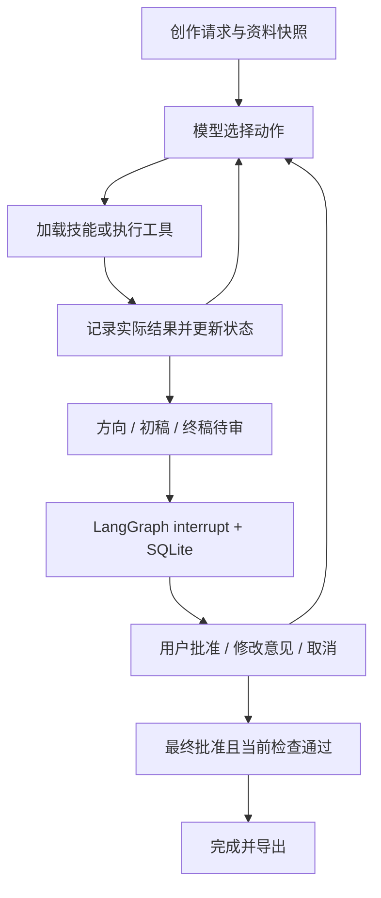

# 方案：模型决策、可核验工具与三阶段人工审核

## 架构与职责

项目采用一个主 Agent。LangGraph 图负责模型调用、工具执行和人审恢复；模型决定加载哪个技能、查询什么、怎样改稿、何时请求审核或说明未完成。Python 负责结构校验、数值计算、版本绑定及完成条件，不能靠模型的一句“检查通过”改变状态。

三个业务工具是 `search_materials`、`estimate_duration` 和 `check_rules`。`load_skill` 是技能加载设施；提交方向、完整提交／局部修改稿件、请求审核、追问和未完成结束是控制动作。业务技能不等同于独立 Agent，也不等同于一个必经图节点。

模型也可以用 `patch_script` 局部修订已保存稿件。当前向模型暴露的 schema 与底层纯函数均允许一次提交 **1 至 20 项关联编辑**，并列出当前稿件中实际存在的路径；数组索引从 0 开始，不是 `scene_id`。`replace` 分支要求字符串 `value`，可修改标题、镜头文字与引用字段；`remove` 分支不接受 `value`，只可删除来源 ID 或断言条目。不能改时长要求、估时参数、检查结果或删除镜头。编辑依次在副本上执行，先替换文字再删除数组项，同一数组按索引降序删除；全部验证成功才保存一个新版本，任一步失败均不修改原稿。成功后清空旧检查，与完整稿提交采用相同终稿门槛。

早期 planner schema 每次只允许 1 项编辑，底层函数当时已支持 20 项。真实复测中，单项限制使旁白、字幕和对应 claim 被分多轮修改，留下中间引用失配并消耗预算，因此现在允许在一个工具动作内原子修改这些关联字段。超过 20 处、需要新增 claim 或重新组织镜头时，可由模型选择完整 `submit_script`。这仍是一次工具调用，执行后再观察结果，不是同一轮并行调用多个工具；修改文字及操作组合由模型决定。

可用动作根据真实前置条件过滤：未取得来源与方法时不能提交稿件；用户初稿先执行两项检查，再暴露编辑动作；同一版本、需求和资料 hash 已有的检查不重复提供，服务失败可再试；已有方向先等待审核；修改稿件后检查重新可用。已加载技能不再出现在加载选项中，但完整正文仍保留在上下文；`used_skills` 仅允许已加载 ID，并限制列表长度。未修改的方向或稿件提交会被拒绝。模型仍在合法动作中选择检索、加载方法、编辑、追问或停止，程序没有预设下一次查询或修改文字。这是带前置条件的动态决策范围，不能用前置过滤本身证明模型具备重规划能力。

当前环境和依赖锁定文件使用 **LangGraph 1.2.18** 与 **langgraph-checkpoint-sqlite 3.1.2**。前者提供 `StateGraph`、条件路由、`interrupt()` 及 `Command(resume=...)`，后者提供 `SqliteSaver`。项目自行实现业务工具、版本约束、模型接口、技能加载和本地恢复锁，没有重新实现框架的图调度或 checkpoint 机制。

图允许以方向、初稿、终稿为执行骨架，但骨架内的下一动作由真实模型通过显式配置的动作协议选择。每轮仅接受一个工具动作，先观察返回再继续。同一轮多个工具调用会得到可见错误，避免同时修改稿件并审核旧版本；单个 `patch_script` 内的关联编辑作为一次原子操作处理。普通文本的成功声明不能直接完成任务。

## 模型接口和失败边界

模型适配层使用标准 Chat Completions 请求。当前主模型由用户选择为 **DeepSeek Flash**，接口为 `https://api.deepseek.com`，模型名为 `deepseek-flash`，使用 `LLM_ACTION_PROTOCOL=native`。请求发送工具 schema 和 `tool_choice="auto"`，接收原生 `tool_calls`。通用兼容接口还发送 `parallel_tool_calls=false`；DeepSeek 请求不发送这个参数，运行时仍限制每轮一个动作。原本的 `http://127.0.0.1:8012/v1` / `qwen25-14b-pbn-answer` 接入和失败记录作为历史保留，不能与新模型结果混算。

DeepSeek 请求显式发送 `thinking={"type":"disabled"}`。当前适配器不保存或回放推理内容，因此不支持开启该服务的 thinking 模式；配置校验会拒绝不兼容组合。规划动作与独立事实核验均使用这个已配置的模型服务。服务地址、模型名、密钥和超时仍可配置，密钥不进入交付记录。

显式设置 `LLM_ACTION_PROTOCOL=json` 时，请求使用 `response_format.type="json_schema"` 和 `strict=true`。每个可用动作对应一个 `anyOf` 分支，以 `const` 固定动作名并绑定其参数 schema；服务必须支持这些结构化输出能力。动作定义也作为提示词发送，不发送原生工具调用参数。模型必须返回单个 `{"action":"动作名","arguments":{...}}` 对象；适配层再次校验动作属于当前可用集合、字段封闭、参数类型和数值／长度约束，拒绝重复 JSON 键及非法数值。解析器可接受单个完整 JSON 代码块，但不从混杂说明或多个对象中猜取动作。通过校验后，适配层生成标明来源的内部调用 ID，交给同一个图和真实工具执行；工具观察继续回传模型。JSON 上下文不把旧 assistant 动作重放成输出示例，保留真实观察、当前状态和动作摘要，完整历史仍保存在 Trace。独立事实核验使用原来的单独提示词，不切换为动作协议。

两种协议均为真实模型选择动作，不是预设动作或 Mock。协议由配置明确选择，失败不触发静默切换。早期 Qwen 接入曾观察到长脚本 JSON 出现在普通正文却没有被服务解析为原生 `tool_calls`；JSON 协议用于显式适配这一接口差异。当前 DeepSeek 接入只允许 `native`，配置为本适配器的 `json_schema` 协议会直接报错。协议及原始可公开响应由实际运行文件记录，不能据配置选项存在就宣称已通过。

当前 DeepSeek 验证配置为 `native`、thinking 关闭、超时 120 秒、单次输出上限 4096 token、单次输入与输出合计的应用预算 16384 token。[首批自动结果](../examples/deepseek-flash/summary.json) 为 8/14，包含四个后经文件复核确认有内容漏检的场景，另六例因余额不足停止。用户充值后，[首次修补复测](../examples/deepseek-flash-recheck/summary.json) 为 10/14；`normal`、`missing_info`、`tool_failure`、`duration_revision` 的已知旧问题在该批次四份终稿中未再发现，有限范围的 AI 文件复核见 [content_review.json](../examples/deepseek-flash-recheck/content_review.json)。这不是完整质量认证或真人签字。

首次修补复测中，`human_feedback`、`headphones`、`query_rewrite`、`too_short` 四例用满 40 次模型预算而未完成，推动了批量编辑、技能 1.1、型号识别、复杂用例预算和时长决策提示的调整。后续批次分别保存在 [deepseek-flash-final](../examples/deepseek-flash-final) 与 [收尾定向验证](../examples/deepseek-flash-validation)；目录名中的 final 不代表所有内容已经最终合格。当前输入、规则与验收仍有收尾修正，最终统计、实际失败及覆盖结论集中见 [评估文档](03-evaluation.md)，不在本设计文档预填结果。旧 Qwen [3/14 结果](../examples/live/summary.json)、首批 DeepSeek 输出与 Trace 均保留为历史。

适配层校验响应结构、工具调用 ID、参数文本、空响应及被截断的响应。传输失败和协议错误保持可见，不静默切换 Mock，不隐式无限重试。真实调用的 token 用量在服务返回时记录；内部 reasoning 字段不作为 Trace 交付。

原生工具配置曾在预检中返回缺少 `--enable-auto-tool-choice` / `--tool-call-parser` 的错误，后续重测已经验证基础工具循环可用。这个预检不等于完整脚本业务验收，业务结果见评估文档。

早期 Qwen 接入出现过 4K 上下文不足的 HTTP 400，用户随后把本地服务升级为 32K。当前请求继续按阶段提供可用动作，以当前需求、稿件、检索原文、检查摘要、最近人工意见和最近一次工具观察构建上下文；持久化状态和完整 Trace 不因此删除。所有已加载技能的完整正文每轮只发送一次，同时保留全部错误定位、分镜估时及最近八次动作摘要；尚未加载的技能只显示目录。方向阶段也可见当前稿件，避免已有初稿被误判为缺失。这种上下文组织与当前配置的 16384 token 应用预算是两项不同机制。

## 单次请求的上下文预算

`LLM_CONTEXT_WINDOW=16384` 是本项目为每次模型请求配置的输入与输出总预算，不是任务累计 token 上限，也不宣称云端模型的最大上下文只有 16K。`LLM_MAX_TOKENS=4096` 为每次请求预留完整输出空间；任务仍另外受请求中配置的模型与工具调用次数限制。

预检使用本地固定版本的官方 `DeepSeek-V4.1-Flash-1017` tokenizer 与对话编码器。具体来源、上游 revision、许可证和 SHA-256 见 [资产说明](../src/script_agent/vendor/deepseek/README.md) 与 [provenance.json](../src/script_agent/vendor/deepseek/provenance.json)。运行时离线加载并验证指纹，不临时下载模型代码。

计数包含完整 messages、工具 schema、响应格式及对话包装：分别计算官方编码器渲染后的 prompt token 和序列化请求 token，取两者较大值，再加 `ceil(10% × 基数) + 128` 的余量，最后加上 4096 输出预留。序列化计数不把用户文本中的特殊 token 字面值当成廉价控制标记。估计总量超过预算时，请求在 HTTP 发出前被拒绝，明确返回 `context_budget_exceeded`，不截断资料或稿件以凑预算。

这些仍是本地参考估算，云端模板和版本可能不同。响应包含合法的 `prompt_tokens` 和 `completion_tokens` 时，再核对服务报告的实际总量；超过预算也返回明确未完成，并记录请求已经发送、响应可供复核。若服务没有提供这两项 usage，不能声称完成了实际用量校验。预检估计、输出预留和响应后检查均留在 Trace；它们不构成云端硬限制，也不能避免已发请求产生费用。配置 `LLM_CONTEXT_WINDOW=0` 可显式关闭本地预算，当前 DeepSeek 验证没有关闭。

## 16 个渐进加载技能

注册目录保存技能名称、描述和版本；系统提示词发送技能 ID 与适用场景描述。模型通过 `load_skill` 读取某一技能的完整正文，包括示例；元数据中的版本、原文件内容和 SHA-256 指纹保存在状态中用于追溯。注册器验证名称与目录、YAML 元数据、版本、非空正文及路径边界，只读取已注册技能，不执行技能文件中的任意代码。

技能分为四组：

| 分组 | 技能 |
|---|---|
| 规划 | 需求澄清、受众与角度、平台适配、叙事结构 |
| 依据 | 素材检索、查询改写、资料冲突、断言与来源绑定 |
| 创作 | 开场、分镜编排、旁白与字幕、画面描述 |
| 修订 | 时长压缩、品牌修订、事实修订、人工意见整合 |

每包的适用边界和可观察产出不同。例如分镜编排负责镜头顺序与信息分配，画面描述负责单镜头主体和动作；来源绑定负责起草时建立映射，事实修订负责处理检查揭示的不支持断言。平台建议是合成创作规范，不引用实时平台政策作为事实。

`human-feedback` 与 `visual-direction` 已从 1.0 更新为 **1.1**，其余技能维持各自 manifest 中的版本。前者要求把意见落实到受影响的标题、旁白、字幕、画面和引用，并将关联改动原子提交；后者明确区分有证据的真实界面与不暗示具体产品交互的抽象动画，增加字幕浮现、文字替换的示意示例。版本和文件指纹用于区分旧运行所用指引，升级技能本身不等于证明效果改善。

Trace 区分 `skill_loaded` 和 `skill_application`。产物中的 `used_skills` 是模型声明的使用关系；最近加载技能与后续动作之间的 `subsequent_action_candidate` 只是一种候选关联。不能把候选关联、模型自报或加载次数单独当成效果证明，应对照查询改变、稿件变化或工具结果审阅。`data/skill_scenarios.json` 是评估设计，实际覆盖须来自真实 Trace。

开发实验中曾出现加载全部 16 个技能后仍未完成任务的循环。这条记录应作为失败案例保留，不能计为 16 项效果验证通过。

部分输入是明确标注的定向能力验证：`missing_info` 指定需求澄清方法，`query_rewrite` 指定空结果后采用查询改写方法，`skill_showcase` 指定平台适配、分镜、画面及开场等技能。这些记录可检查模型是否遵循方法、产物是否体现应用，但不能证明自主选择技能的能力，也没有不加载技能的对照实验来证明增益。普通业务场景和这类定向场景应分别解读，不能把两类加载数量相加就宣称自主覆盖全部技能。

`skill_showcase` 始终要求恰好三个镜头。收尾输入将其明确为 S1 说明需求、S2 只讲 P01 自动生成、S3 讲 P04 检查及 P02 手动修改，不加入 P03 样式调整，也不新增总结镜头。这是在保持原三镜头约束下消除歧义，不是把先前四镜头输出放宽为合格。

## 资料、版本和工具检查

启动任务时读取资料与规则并保存快照及数据 hash。后续恢复使用任务中的快照，避免外部文件变化悄悄改变已审核稿件的依据。已有任务补充产品资料的完整增量流程不在第一版内；需要新资料时更新资料集并发起新任务。用户可以在澄清阶段补充创作要求。

检索采用中文二元词、英文词和关键词的本地相关性评分，返回原文与来源。它不是联网检索，也没有向量数据库。显式 `conflict_group` 可提示同范围资料冲突；这种标记只能覆盖已构造的冲突场景，不能被表述为通用事实冲突检测器。

估时采用固定配置：中文有效字符每秒 4 个，英文词每秒 2.5 个，字幕字符每秒 6 个；旁白中的短停顿与句末停顿分别增加 0.2 和 0.4 秒。单镜头取旁白、字幕阅读、最低画面展示三者的最大值，镜头串行累加，并计入配置的转场时间。默认转场为 0 秒。数字读法、缩写、表演及真实配音存在误差，因此结果始终标为估计时长。

规则检查有两层：

1. 确定性检查：稿件结构、来源和镜头存在、引用原文匹配、断言是否出现在稿件、分镜来源映射、禁词、无依据数字和显式资料冲突。新增规则配置 `evidence_required_terms`，按 `feature`、`ui_detail` 两组检查导出、按钮、滑块、进度条、时间线、面板等已知漏检词。字段出现配置词时，要求同字段中有有效断言，且该断言和对应支持原文都包含该词；否则定位到具体字段与编辑路径。它是配置化字面词回归检查，不能覆盖全部同义表达或替代语义理解。
2. 独立模型核验：确定性检查通过后，用单独提示词核对标题、画面描述、旁白和字幕的全部产品断言，包括没有列入 `claims` 的操作与界面细节。提示词明确要求每条 claim 的完整含义由该条自己的 `source_id` 和 `quote` 独立支持，不能借同镜头另一条引用补齐复合事实。仅“支持自动字幕”不能推出某按钮、进度条或导出操作。写成“示意”也不豁免功能事实；不暗示具体产品交互的抽象画面则可作为创作建议。核验结果格式错误、漏检声明断言或判为 `unsupported` / `uncertain` 时不能通过。

检查结果现在区分 `scope`、`requires_semantic_verification` 和 `semantic_status`。确定性规则的局部通过仍是 `not_checked`；实际语义核验后标记 `passed` 或 `failed`，服务／解析异常标记 `unavailable`，不会被包装成语义通过。异常另写 `semantic_error` 事件，包含错误、可用 usage 和响应元数据，保留核验失败的证据。

收尾新增 `scene_evidence_terms` 作为另一项明确配置的规则。镜头中出现“自动生成”“手动修改”“主动降噪”等配置功能短语时，该镜头必须有自己的来源 ID，以及至少一条有效且显式绑定该 `scene_id` 的 claim；全局 claim 或前一镜头的引用不能替代。缺失时记录 `MISSING_SCENE_EVIDENCE` 并定位字段。此规则只拦截配置功能镜头完全没有自身证据的情况：一个有效 claim 并不保证该镜头每个断言都受支持，未列短语也不因此自动合格，仍需逐项语义核验。

数字检查增加了狭窄的型号例外：当完整字母数字型号（如 `H1`）在来源原文中确实出现时，不把它内部的 `1` 单独认定为无依据性能数字。未见于原文的型号、独立性能数值、百分比及单位仍按原规则核对；这不是放开数字事实要求。

模型核验已经在本次真实记录中出现漏判，复测中对口语化措辞的支持判断也有波动。当前规划与核验都使用 DeepSeek Flash，只是提示词和请求独立，不是另一个外部事实来源或保证。字面词表还可能把“不要展示按钮”这类否定描述报为缺证据，且不能覆盖未列同义表达。内容复核须区分明确无依据的产品功能／界面、需要确认的含义，以及主观创作措辞建议；不能把个人偏好一律记成确定虚假事实。各轮有限审阅不能证明事实检查完备，当前真实复验和技能效果证据统一见评估文档。

每次提交脚本增加版本并清空旧检查。检查保存脚本版本、内容 hash、资料 hash 和创作需求 hash；进入终稿审核及最终完成时再次验证当前稿件的检查有效性。模型不能通过提高语速、手填通过状态或使用旧稿检查来绕过约束。

## 人工审核与持久化

方向审核展示表达角度、大纲与拟用事实。初稿审核展示稿件及初步检查，可以包含明确标注的问题；批准仅代表认可表达方向，不豁免检查失败。终稿审核必须等待当前时长和规则／事实检查全部通过。

用户选择 `revise` 时提交文字意见，模型负责修改。原稿未发生变化时不能声称已经完成稿件修订。若意见涉及硬性要求变化，模型应请求明确的字段补充，补充后回到方向阶段。取消保留已有产物并标记 `cancelled`。

反馈必须覆盖受影响的全部字段。例如“删掉开场反问句”既涉及第一镜旁白，也涉及字幕；只改旁白而字幕仍保留问号不算落实意见。`human_feedback` 固定评估用例因此新增首镜 `narration` 与 `subtitle` 均不得保留中英文问号的判据，仍要求实际修订和再次审核。这是该用例的可执行判据，不代表能穷尽所有自然语言反馈。

硬性时长不满足时，模型可在真实压缩并重新估时、通过 `ask_user` 请求调整时长、明确 `finish_incomplete` 之间选择。一般措辞或引用修正无需重复请示，但不能因此压制真实约束冲突的追问或停止。提示词依据实际估时与保留事实后的可行性说明选择边界，没有把“1 秒”输入硬编码为某个动作；未经确认不能改变原目标。

`too_short` 曾安全地提前请求调整时长，但该路径缺少本用例要求的实际测量证据，因此未通过其验收。当前输入明确要求先形成保留两项功能的候选稿并调用时长工具，再决定压缩、追问或未完成。程序没有据目标值替模型预选答案；安全停止与满足一条指定证据链是不同判据，不能混写。

每个待审请求有独立 `review_id`，对应阶段和版本；恢复必须提供当前 ID。重复批准、旧审核 ID、非待审状态以及用批准代替澄清答案会被拒绝。使用稳定任务 UUID 作为 LangGraph `thread_id`，SQLite 保存 checkpoint，使 CLI 能跨进程恢复。

`interrupt()` 恢复时会重新执行所在节点，因此人审节点只负责中断与接收回复。模型请求、工具操作和计数在其他图节点执行，导出在运行时完成。`resume` 从读取当前状态到继续执行和保存产物，均持有按任务 ID 创建的操作系统文件锁。Windows 使用 `msvcrt.locking`，POSIX 使用 `fcntl.flock`，获取失败立即返回“另一进程正在处理”，避免同时消费同一个人审请求。正常退出或进程崩溃后，操作系统释放锁。

这提供单机 CLI 的人审恢复互斥，不提供分布式锁、用户权限、审核队列或多文件导出的原子事务。CLI 的恢复入口要求任务正处于 `waiting_human`；不承诺在模型调用或工具执行中途杀进程后自动从任意节点续跑。正常暂停后，可在新的进程中使用同一状态目录、任务 ID 和当前审核 ID 恢复。

默认模型请求上限 40 次、工具调用上限 60 次；事实核验也消耗模型请求次数。等待人工不清零计数。达到上限输出 `incomplete` 和原因；模型服务失败为 `failed`；只有终稿批准且当前检查有效才是 `completed`。

当前 `human_feedback`、`headphones`、`query_rewrite` 三份复杂输入显式设置 60 次模型请求、80 次工具调用；普通输入维持 40/60，`step_limit` 仍使用自身更小的测试预算。预算增加使包含检索改写和多字段修订的任务有更多执行空间，同时提高最大成本。它不证明决策更好，和旧 40 次运行比较时必须注明预算变化。

LangGraph 的 `recursion_limit` 按请求预算计算为 `4 × (max_model_calls + max_tool_calls) + 20`，为模型、工具和审核节点留出图步数。业务调用预算仍由持久化计数器执行，图上限不替代预算，也不随人工回复重置计数。提高预算后的实际回归结果见评估文档。

## 可复现记录与技术取舍

导出包含输入、最终／中间输出、资料快照、脚本版本、Markdown 脚本和逐步 Trace。记录包括模型动作、工具参数与返回、简短依据、技能事件、人工意见和调用累计数。评估程序模拟的人类回复标记为 `evaluation_simulated_human`，不能冒充真人逐条批准。

选择 CLI 和 SQLite 是为了把三天工作集中在决策、恢复与验证。单 Agent 加技能降低跨 Agent 状态协调成本；本地 JSON 和词法检索便于精确替换资料和复现实验；后续可以独立替换检索或模型适配层。实际使用的框架版本以提交的依赖锁定文件为准。

参考设计：[LangChain Skills](https://docs.langchain.com/oss/python/langchain/multi-agent/skills)、[LangGraph Interrupts](https://docs.langchain.com/oss/python/langgraph/interrupts)、[LangGraph Persistence](https://docs.langchain.com/oss/python/langgraph/persistence)、[Agent Skills 格式](https://agentskills.io/specification)。这些参考说明机制，不替代本项目测试结果。
